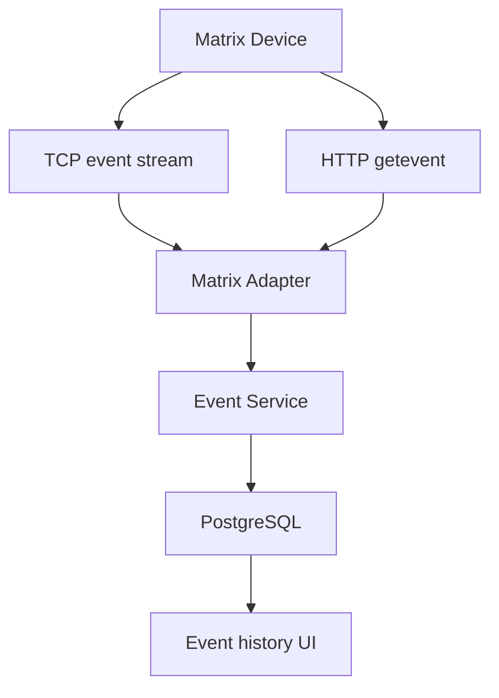
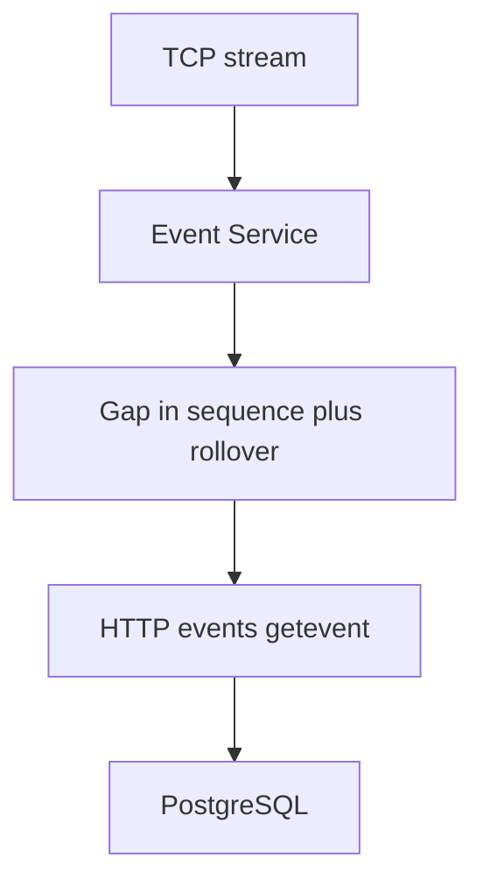

# Events

**Status:** **PLANNED.** The `events` module is a placeholder. Facts below are from the COSEC Devices API User Guide v28 unless marked for verification.

## What an event is

An **event** is a **record the device already produced**: access allowed/denied, enrollment activity, alarm, system message, and other codes listed in the guide appendix.

It is **not**:

| Term | Meaning |
|---|---|
| **Event** | Historical fact reported by the device (`event-id`, details, time, seq). |
| **Command** | An API the application sends (`lockdoor`, `geteventcount`, `enrolluser`, …). |
| **Access decision** | The door controller deciding whether to grant entry **at the hardware**. |

Typical path:

```text
Person presents credential
    → Matrix device performs the access operation
    → Access result occurs at the door
    → Device reports an event
    → Application stores the event
```

This desktop application does **not** necessarily perform every real-time biometric match. Matching is expected to occur **on the device**. **Requires verification against the specific Matrix device model/API documentation** for a given reader/biometric engine.

## Architecture (planned)



## Real-time collection (TCP)

Verified API:

```text
http://<deviceIP:deviceport>/device.cgi/tcp-events?action=getevent&ipaddress=<app>&port=<listen>&roll-over-count=<n>&seq-number=<n>
```

The application (or a helper listener) is the **TCP server**; the device **pushes** events.

Guide notes:

- `trigger` start/stop; `keep-live-events` continuous vs limit
- `ipaddress` and `port` are **mandatory** in the parameter table
- `roll-over-count` and `seq-number` required unless `keep-live-events=1` (per that table)
- Default TCP ACK is used to send the **next** event
- **Not supported on Direct Door V2**
- If the device **reboots** during transfer, the prior send-events command is **invalid**; the client must re-request
- User id on the event is the numeric **reference id**

Exact TCP payload framing beyond the HTTP setup call **Requires verification against the specific Matrix device model/API documentation.**

## HTTP retrieval and recovery

Verified API:

```text
http://<deviceIP:deviceport>/device.cgi/events?action=getevent&roll-over-count=<n>&seq-number=<n>&no-of-events=<k>
```

`roll-over-count` and `seq-number` are **mandatory**. They identify the **first** event of the batch.

`no-of-events` limits (guide table):

- 1–5: Direct Door V2, Path Controller, IO Controller
- 1–100: other Direct Doors listed there

Response examples include XML with `roll-over-count`, `seq-No`, `date`, `time`, `event-id`, `detail-1` … `detail-5`. Detail field meaning **depends on event type and device**; see the guide appendix. **Requires verification against the specific Matrix device model/API documentation.**

### Missed TCP events (verified policy)

If an event is missed on TCP, the **third party** must re-request it. That **must not** use the TCP port. Missed events are recovered with the **HTTP** event API.



## Sequence numbers and rollover

| Field | Guide |
|---|---|
| `seq-number` | Per-device range (examples: V2 1–50,000; several models up to 500,000) |
| `roll-over-count` | `0–65535`; used together with seq when the seq space wraps |

`geteventcount` (`/device.cgi/command?action=geteventcount`) returns the device’s **current** sequence number and roll-over count (XML example in the guide). Useful for catching up and for monitoring.

When seq wraps, **both** fields are required to order events. Application storage should treat `(device, roll-over-count, seq-number)` as the vendor identity for deduplication.

## Duplicate protection (planned)

TCP retry, HTTP overlap, and crash recovery can deliver the same event twice. The event service should insert **idempotently** on the vendor key (and ignore duplicates). Do not invent extra uniqueness until the schema pass.

## Event persistence and history (planned)

PostgreSQL `events` (conceptual) stores:

- Device identity (application UUID)
- Rollover + sequence
- Timestamp **as reported** plus `ingested_at` UTC
- `event-id` and detail fields
- Raw payload optional (for forward compatibility)

The React UI reads **through Rust**, never from the device.

## Cursor / catch-up (planned)

Per device, persist the last **successfully stored** (rollover, seq). On startup:

1. Optionally `geteventcount`
2. Resume TCP from next seq if the model supports it
3. HTTP-fill any gap

## Event configuration appendix

The guide’s appendix lists user events, alarm events, system events, cafeteria events, and field encodings. This project will **not** copy that table into code until a service implements parsing. Until then, unknown `event-id` values are stored, not guessed.

## Out of scope for this document

- Claiming the desktop app is in the biometric matching loop
- Using TCP to fill missed events
- Treating `geteventcount` as a list of events (it is current seq + rollover)

## Desktop poll settings

The running app polls active readers on a timer. These settings are environment variables, read at startup. They are separate from how many readers can be registered.

| Variable | Default | Allowed | Effect |
|---|---|---|---|
| `VSMART_POLL_CONCURRENCY` | 4 | 1–40 | Readers contacted at the same time |
| `VSMART_POLL_INTERVAL_SECS` | 30 | 5–3600 | Target time from the start of one cycle to the start of the next |

A value outside the allowed range is clamped and reported on the dashboard. The process still starts. Forty concurrent readers is allowed when set. It is not the recommended default. If enrollment waits or PostgreSQL refuses connections, set concurrency back to 4.

The database pool is `concurrency + 3` connections, and at least 5. The extra three stay available for enrollment, user management, and the window. A poll does not hold a connection while it waits on a reader.

A reader counts as reached only after the device answered and the visit's writes committed. `SECRET_CORRUPT` means the stored password does not decrypt with this workstation's key. Set that password again. The app does not replace or re-encrypt it. `SECRET_UNAVAILABLE` means the key file could not be read. A connection timeout stays `MATRIX_TIMEOUT`.

Each visit still requests events in batches of 5, which is the documented limit for direct-door controllers, and stops after 20 batches (100 events) so one backlog cannot take the whole cycle. The next cycle continues from the stored checkpoint. The checkpoint and the batch are committed in one transaction, so a crash cannot move the checkpoint past events that were not stored. A repeated sequence for the same reader is ignored.

A reader that fails waits before the next attempt. The wait grows from 15 seconds and stops growing at 10 minutes, with a small per-reader offset so the retries do not line up. A reader that is busy with enrollment is skipped and is not counted as a failure. Three authentication failures in a row are shown as needing an operator. Restarting the app clears these waits. Stored events and checkpoints remain in PostgreSQL.

These timings come from the scheduler. They are not a measurement of physical Matrix hardware.
